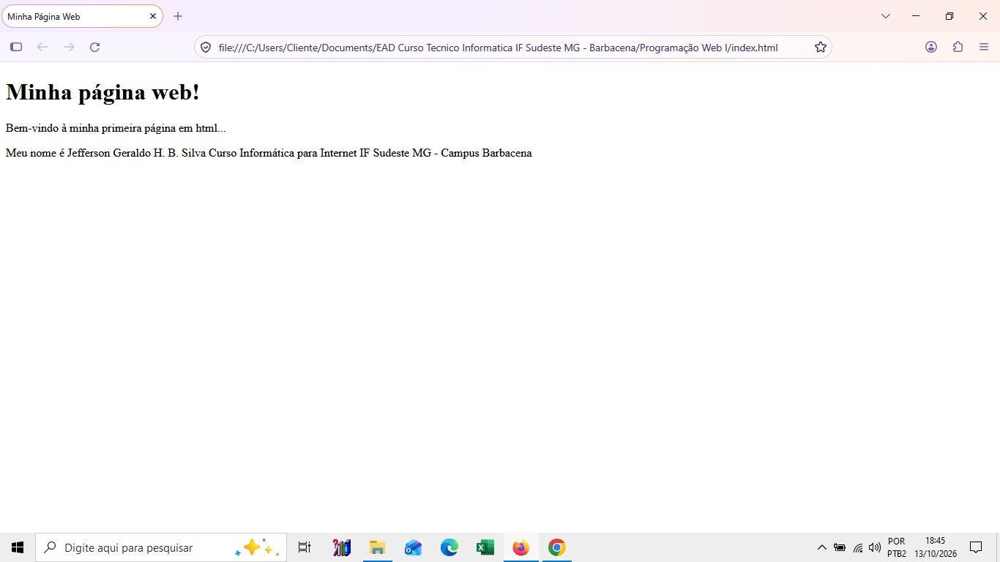
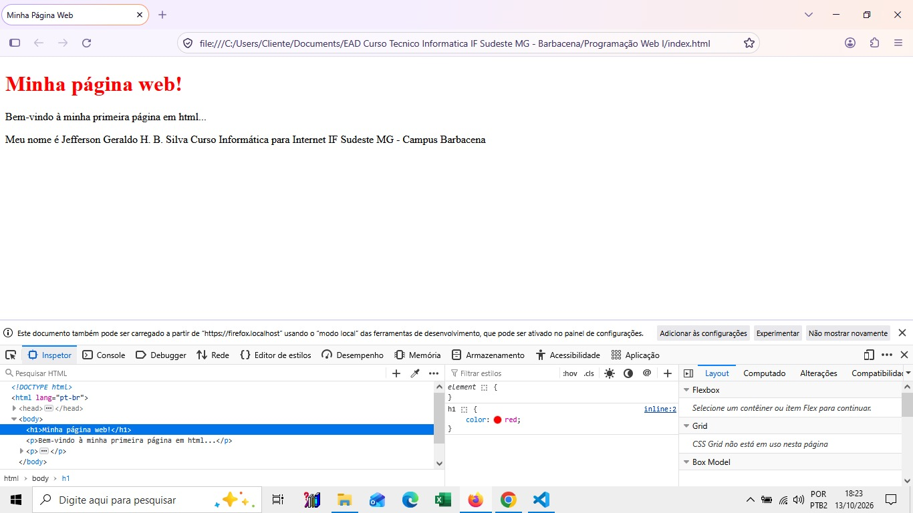

# Minha primeira página Web
Nome: Jefferson Geraldo Henriques Barbosa Silva
## Sobre a atividade
Esta é minha primeira página desenvolvida na disciplina
Programação Web.
## Tecnologias utilizadas
- HTML
- Git
- GitHub

## Capturas de tela

### Página 1 do navegador

### Utilização do Devtools

